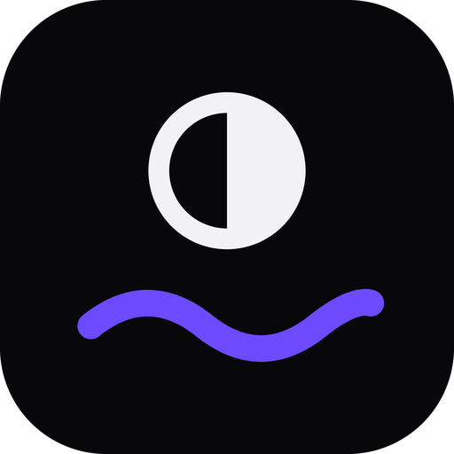
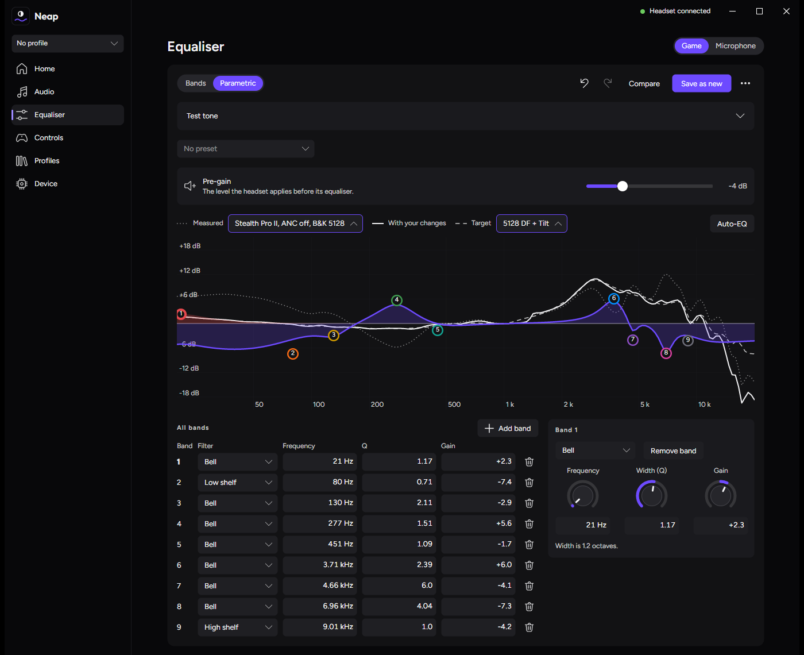
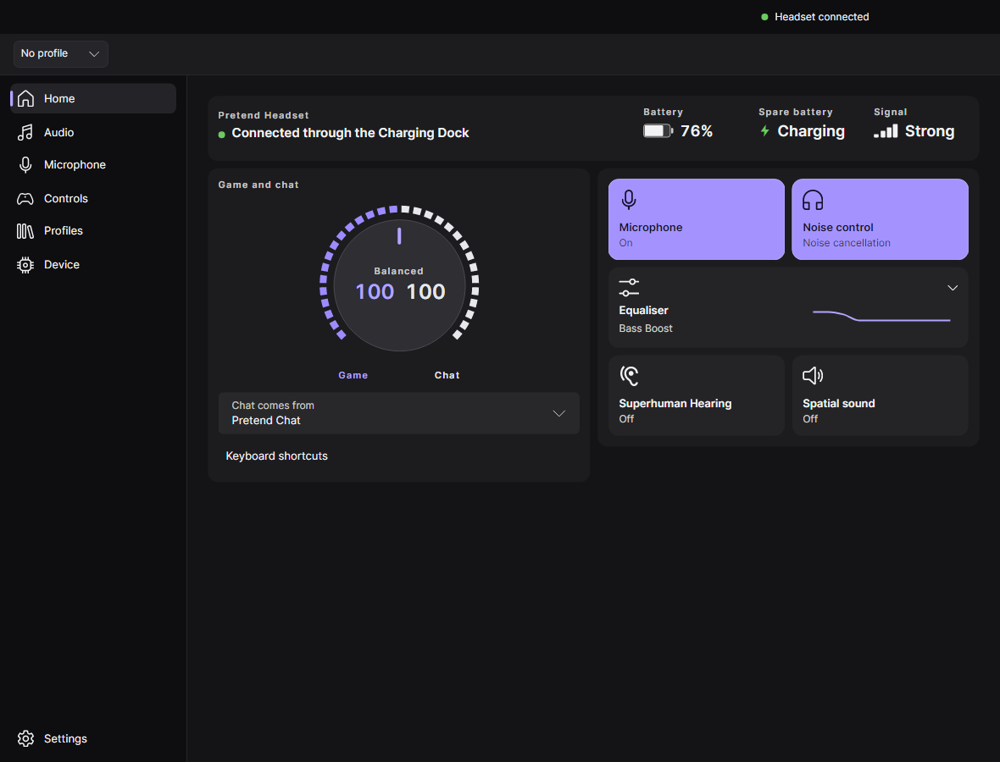
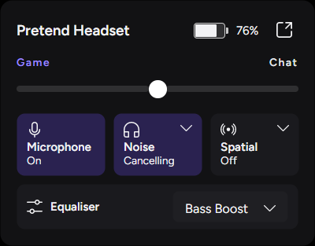
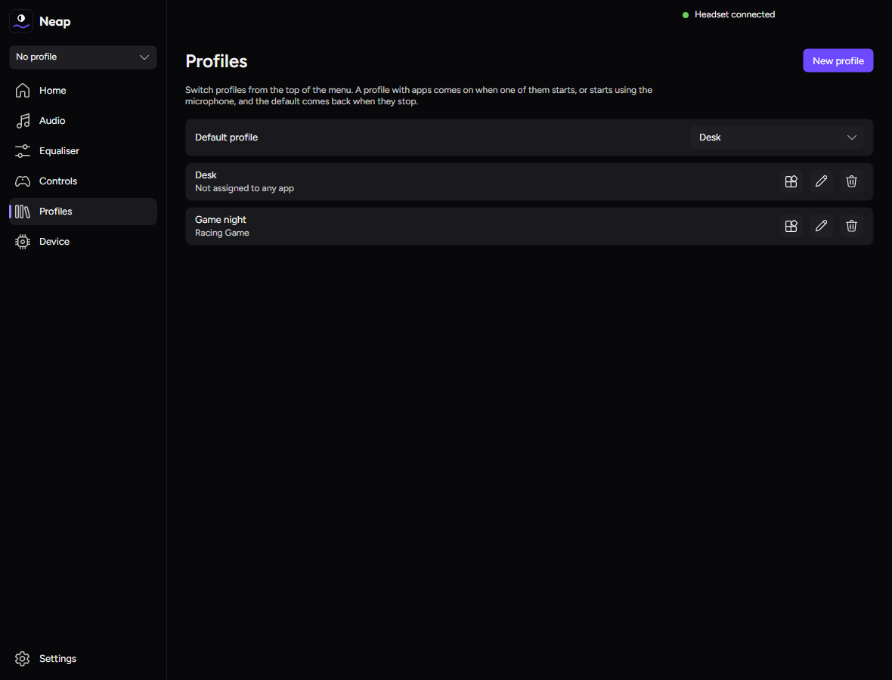

# Neap

**Full control of your Turtle Beach headset on Windows and Linux, without
Swarm II.** A true parametric equaliser, a game and chat mix that needs no
driver, profiles that follow your games, and every setting the headset has,
in one quiet app.

**[Download the latest release](https://github.com/lykosapps/Neap/releases/latest)**
· Windows 10 version 2004 or later · Linux with PulseAudio or PipeWire ·
64-bit

## Why Neap

- **No Turtle Beach software.** No Swarm II running in the background, no
  Waves driver, no admin rights, no reboot.
- **Windows and Linux,** the same app on both, Steam Deck included.
- **Private by design.** No account, no analytics, nothing from your PC or
  headset leaves it. The one network call is the update check, and it can
  be turned off.
- **Free and open source,** under the GPL.

## Headsets

| Headset | Windows | Linux | Parametric equaliser |
|---|---|---|---|
| Stealth Pro II (Xbox) | Yes | Yes | Yes |
| Stealth Pro II (PlayStation) | Yes | Yes | Yes |
| Atlas Air | Yes, with two owners testing | Yes | In testing |

Neap shows only what each headset has. Own another Turtle Beach headset
that works with Swarm II? A ten-minute recording made in Neap is where its
support starts, with no technical knowledge needed.
**[Here's how](docs/MAPPING.md).**

## What it does

### A true parametric equaliser

A ten-band equaliser gives you sliders at fixed frequencies. Neap unlocks
the Stealth Pro II's own filters: choose where each of its ten bands
sits, its shape and how wide it is, and the headset plays the curve as
drawn, through the Charging Dock or the cable.

- **Six filter shapes:** bell, low and high shelf, low and high cut, and
  notch, each with frequency, width and gain.
- **Start from a measurement.** The Stealth Pro II's measured response is
  built in, with and without noise cancellation. Set it against a target
  and Auto-EQ fits the bands for you.
- **Bring your own.** Import AutoEq and Equalizer APO filters, or load
  your own measurements and targets.
- **Tune by ear.** A test tone plays through the headset to find a peak,
  hold Compare to hear it without your changes, and undo anything.
- **Keep it.** Save presets, start from built-in shapes, and put a curve in
  a profile.
- **Safe to try.** Turn it off and the headset goes back to its own ten
  bands. If the headset, its phone app or Swarm II changes the equaliser,
  Neap steps back too, and keeps your curve.

### Ten-band equalisers, stored on the headset

Game and microphone equalisers with presets saved on the headset itself, so
they show in the phone app too and survive uninstalling everything.

### A game and chat mix, with nothing to install

Pick your chat apps, such as Discord or Teams, and Neap balances them
against everything else. Turn the headset's chat wheel, the dial on Home,
or a keyboard shortcut in game. No virtual cable or driver, and it works on
the Xbox edition, where Swarm II's mix isn't officially supported.

### A mini panel for mid-game

Click Neap's icon by the clock for the mix, the microphone, noise
cancellation, spatial sound, Superhuman Hearing, the equaliser preset and
the profile in use. Choose which ones it shows.

### Profiles that follow your games

Save your whole setup under a name, from noise cancellation to both
equalisers and the mix. A profile comes on when its game starts and goes
back to your default when it closes. A call app such as Teams can switch
only while it's on a call.

### Everything else

- **Every setting the headset has:** noise cancellation and transparency,
  the microphone and its noise gate, Superhuman Hearing, buttons, lights,
  power and the Charging Dock's spare battery.
- **The microphone follows the headset's mute,** from the boom arm or the
  button.
- **Pre-gain** lifts a headset that's too quiet, and leaves room for
  equaliser boosts.
- **Catches the wrong device** when sound or calls go somewhere the headset
  isn't, and on Windows fixes it in one press.
- **Clear status:** connected, no sound, off or out of range, each with what
  still works and what to do.
- **Updates itself** with one press, on Windows and from the Linux AppImage,
  checked against the checksum published with each release.

### Coming soon

**Changes to the headset's own firmware,** written by Neap: the Mode
button stepping through transparency without Neap running, and new light
patterns, starting with the light switching off when the headset
disconnects instead of blinking.

## Built to be relied on

- **Tested on the hardware.** Every release is checked on a real headset,
  and Neap writes only settings already proven on one.
- **Nearly 2,000 automated tests,** and scripted checks that drive every
  screen in light, dark and high contrast.
- **Accessible:** built to WCAG 2.2 AA, it works fully from the keyboard and
  with screen readers.
- **Nothing fails silently.** When something can't be done, Neap says so,
  and a recording made in Settings captures what happened for a bug report.

## Install on Windows

1. Download `Neap-<version>-win-x64.zip` from the
   [latest release](https://github.com/lykosapps/Neap/releases/latest).
2. Unzip it to a folder of its own and run `Neap.exe`. Windows warns the
   first time, as the download isn't signed yet: choose **More info**, then
   **Run anyway**.
3. Remove Swarm II, or stop it running, and remove the Waves audio driver;
   see [Alongside Swarm II](#alongside-swarm-ii-windows).

**To update,** choose **Update and restart** in Settings when Neap says a
newer version is out. **To remove it,** delete its folder and
`%LOCALAPPDATA%\Neap`.

## Install on Linux

1. Download `Neap-<version>-x86_64.AppImage` from the
   [latest release](https://github.com/lykosapps/Neap/releases/latest).
2. Make it runnable (`chmod +x`, or **Allow executing as a program** in your
   file manager) and run it.
3. If Neap can't reach the headset, choose **Allow access** and enter your
   password once.

If it asks for FUSE, install `libfuse2`. **To update,** choose **Update and
restart** when Neap says a newer version is out. **To remove it,** delete
the file and `~/.local/share/Neap`, and `/etc/udev/rules.d/70-neap.rules` if
you allowed access.

**Not on Linux yet:** the Steam Deck's Gaming Mode (use desktop mode),
Windows' spatial sound and audio format, and the mix's live meters. On
Wayland, keyboard shortcuts work while a game, or another X11 program, is in
front.

## Alongside Swarm II (Windows)

Swarm II is optional. Neap covers the headset's settings, and the Turtle
Beach phone app updates its firmware.

1. **Remove Swarm II,** or, if you keep it, stop it starting with Windows,
   as the two apps fight over the headset: in Swarm II, Settings → App
   Settings → turn off **Autostart Swarm II**, then close it.
2. **Remove the Waves audio driver.** In Windows Settings → Apps, uninstall
   **Turtle Beach Audio Driver**.

## Help and feedback

**Found a problem?** In **Settings → Problems and other headsets**, record
while it happens, then choose **Report on GitHub**, or
[open an issue](https://github.com/lykosapps/Neap/issues). For a security
problem, see [SECURITY.md](SECURITY.md). The [changelog](CHANGELOG.md) says
what's new in each release.

Neap is in daily use and young. It was written with AI assistance.

Not affiliated with or endorsed by Turtle Beach. Turtle Beach, Stealth Pro
II, Atlas Air and Swarm II are trademarks of Turtle Beach Corporation.

## For developers

- [CONTRIBUTING.md](CONTRIBUTING.md): building, testing, the probe, and the
  checks that need a headset
- [FINDINGS.md](FINDINGS.md): the headset's protocol and behaviour, as
  measured
- [ARCHITECTURE.md](ARCHITECTURE.md): how the app is put together
- [BACKLOG.md](BACKLOG.md): bugs, features and work still to do

## Licence

Copyright (C) 2026 lykosapps

This program is free software: you can redistribute it and/or modify it
under the terms of the GNU General Public License as published by the Free
Software Foundation, either version 3 of the License, or (at your option)
any later version. It is distributed in the hope that it will be useful, but
WITHOUT ANY WARRANTY; without even the implied warranty of MERCHANTABILITY or
FITNESS FOR A PARTICULAR PURPOSE. See [LICENSE](LICENSE) for the full text.

The third-party components it uses keep their own licences; see
[THIRD-PARTY-NOTICES.txt](THIRD-PARTY-NOTICES.txt).
