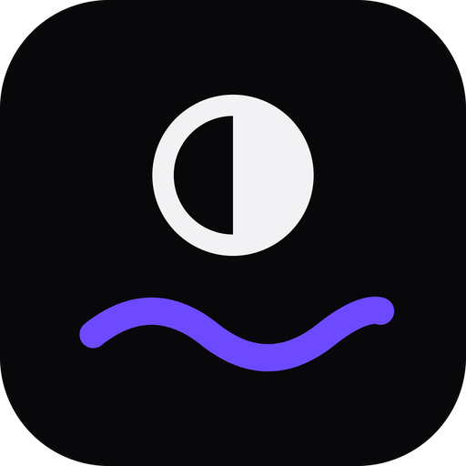
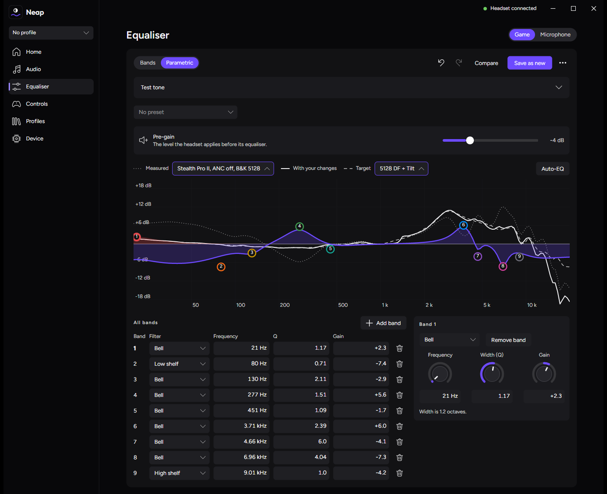
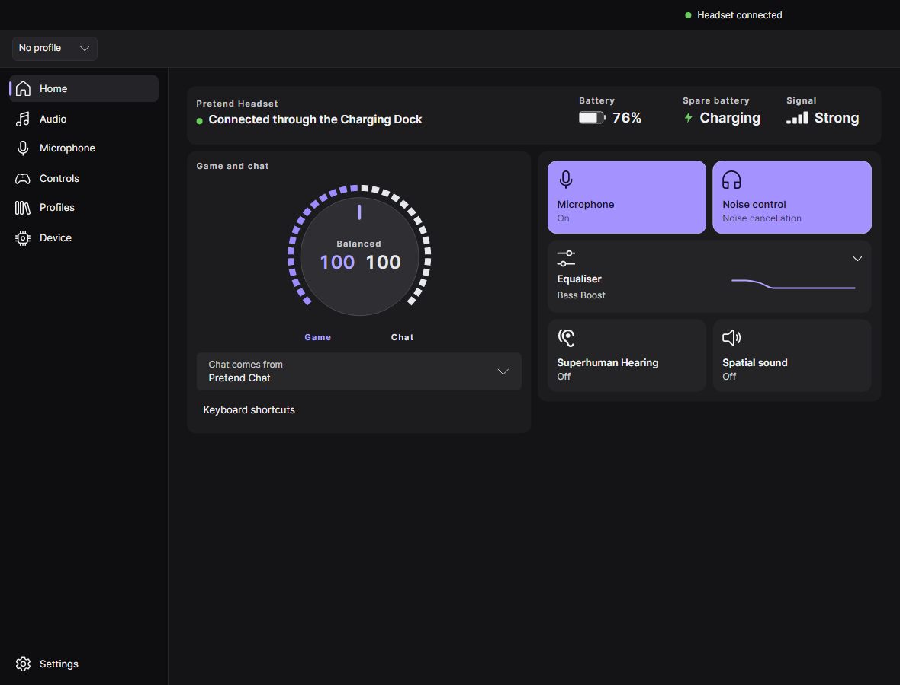
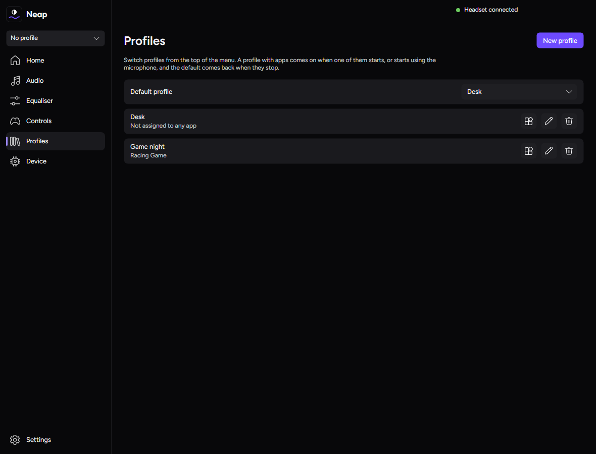
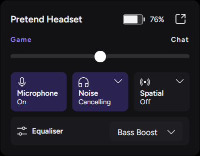

# Neap

**Control your Turtle Beach headset on Windows and Linux, without Swarm II.**
A true parametric equaliser, a game and chat mix that needs no driver,
profiles that follow your games, and every setting the headset has, in one
quiet app.

**[Download the latest release](https://github.com/lykosapps/Neap/releases/latest)**
· Windows 10 version 2004 or later · Linux with PulseAudio or PipeWire ·
64-bit

## Why Neap

- **No Turtle Beach software.** No Swarm II in the background, no Waves
  driver, no admin rights, no reboot.
- **Windows and Linux,** the same app on both, Steam Deck included.
- **Private.** No account and no analytics. The only thing Neap sends
  anywhere is its update check, and you can turn that off.
- **Free and open source,** under the GPL.

## New in 0.5.0

- **Transparency on the Mode button, even with Neap closed.** On Windows,
  Neap can change the Stealth Pro II's own firmware so its Mode button steps
  through off, transparency and noise cancellation, and its light stays dark
  while it's disconnected. It backs up first, checks every change, and can
  put the factory firmware back.
- **A parametric equaliser for the Atlas Air,** the same one the Stealth
  Pro II has.
- **The mix on screen.** Turn the chat wheel in a game and a slim bar shows
  where the game and chat balance sits, without taking your mouse or
  keyboard.

The [changelog](CHANGELOG.md) has every release.

## What it does

### A true parametric equaliser

Most headset apps give you ten sliders at fixed frequencies. Neap unlocks
the headset's own filters: put each band where you want it, pick its shape
and width, and the headset plays the curve as drawn.

- **Six filter shapes:** bell, low and high shelf, low and high cut, and
  notch.
- **Start from a measurement.** The Stealth Pro II's measured sound is built
  in. Set it against a target and Auto-EQ fits the bands for you.
- **Bring your own.** Import AutoEq and Equalizer APO filters, or load your
  own measurements and targets.
- **Tune by ear.** Play a test tone to find a peak, hold Compare to hear the
  difference, and undo anything.
- **Safe to try.** Turn it off and the headset goes back to its ten bands.
  If another app changes the equaliser, Neap steps back and keeps your
  curve.

### A game and chat mix, with nothing to install

Pick your chat apps, such as Discord or Teams, and Neap balances them
against everything else. Use the headset's chat wheel, the dial on Home or
a keyboard shortcut. There's no virtual cable or driver, and it works on the
Xbox edition, where Swarm II's mix isn't supported.

### Profiles that follow your games

Save your whole setup under a name, from noise cancellation to both
equalisers and the mix. A profile comes on when its game starts and goes
back to your default when it closes. A call app such as Teams switches only
while you're on a call.

### A mini panel for mid-game

Click Neap's icon by the clock for the mix, the microphone, noise
cancellation, spatial sound, Superhuman Hearing, the equaliser preset and
your profile. You choose which ones it shows.

### And the rest

- **Every setting the headset has,** from the microphone's noise gate to
  the lights and the Charging Dock's spare battery.
- **Your microphone follows the headset's mute,** from the boom arm or the
  button.
- **Sound in the right place.** Neap notices when sound or calls go to the
  wrong device, and on Windows fixes it in one press.
- **Clear status:** connected, no sound, off or out of range, each with
  what still works and what to do.
- **Updates itself** in one press, checked against the release's checksum.

## Feature map

What each headset gets, and where it works. **New** marks what arrived in
0.5.0.

✓ works · **Try** the headset has it and Neap offers it, but can't read it
back yet · — not on this headset or system

### Sound

| Feature | Stealth Pro II | Atlas Air | Windows | Linux |
|---|:-:|:-:|:-:|:-:|
| Parametric equaliser | ✓ | ✓ **New** | ✓ | ✓ |
| Ten-band game equaliser, presets on the headset | ✓ | ✓ | ✓ | ✓ |
| Auto-EQ from a built-in measurement | ✓ | — ¹ | ✓ | ✓ |
| Pre-gain | ✓ | — | ✓ | ✓ |
| Noise cancellation and transparency | ✓ | — | ✓ | ✓ |
| Superhuman Hearing | ✓ | ✓ | ✓ | ✓ |
| Spatial sound (Windows Sonic, Dolby Atmos) | ✓ | ✓ | ✓ | — |
| Game and chat mix | ✓ | ✓ | ✓ | ✓ |
| The mix on screen | ✓ | ✓ | ✓ **New** | — |
| Keyboard shortcuts for the mix | ✓ | ✓ | ✓ | ✓ ² |

### Microphone

| Feature | Stealth Pro II | Atlas Air | Windows | Linux |
|---|:-:|:-:|:-:|:-:|
| Mute that follows the headset | ✓ | ✓ | ✓ | ✓ |
| Monitoring (hear your own voice) | ✓ | ✓ | ✓ | ✓ |
| Microphone equaliser | ✓ | ✓ | ✓ | ✓ |
| Noise gate | ✓ | Try | ✓ | ✓ |
| AI noise reduction | ✓ | — | ✓ | ✓ |

### The headset

| Feature | Stealth Pro II | Atlas Air | Windows | Linux |
|---|:-:|:-:|:-:|:-:|
| Battery, and the Charging Dock's spare | ✓ | Battery | ✓ | ✓ |
| Mode button, lower dial and chat wheel | ✓ | — | ✓ | ✓ |
| Transparency on the Mode button without Neap ³ | ✓ **New** | — | ✓ | — |
| Light off while disconnected ³ | ✓ **New** | — | ✓ | — |
| Lights | ✓ | Try | ✓ | ✓ |
| Auto shut-off and voice prompts | ✓ | ✓ | ✓ | ✓ |
| Wake on motion | ✓ | — | ✓ | ✓ |

### The app

| Feature | Stealth Pro II | Atlas Air | Windows | Linux |
|---|:-:|:-:|:-:|:-:|
| Profiles that follow your games | ✓ | ✓ | ✓ | ✓ |
| Mini panel | ✓ | ✓ | ✓ | ✓ ⁴ |
| Fixing sound sent to the wrong device | ✓ | ✓ | ✓ | Warns |
| Updates itself | ✓ | ✓ | ✓ | ✓ |

**Notes**

1. There's no built-in measurement of the Atlas Air yet. Load one of your
   own and Auto-EQ works the same.
2. On Wayland, only while a game or another X11 program is in front.
3. A firmware edit: turn on **Firmware edits** in Settings. Swarm II updates
   remove them; remove them yourself before contacting Turtle Beach.
4. On desktops that show tray icons.

The full detail, headset by headset and with how sure each part is, is in
[docs/headsets](docs/headsets).

## Headsets

| Headset | Windows | Linux |
|---|---|---|
| Stealth Pro II (Xbox) | ✓ | ✓ |
| Stealth Pro II (PlayStation) | ✓ | ✓ |
| Atlas Air | ✓, with two owners testing | ✓ |

Neap shows only what your headset has. Own another Turtle Beach headset
that works with Swarm II? A ten-minute recording made in Neap is how its
support starts, and it needs no technical knowledge.
**[Here's how](docs/MAPPING.md).**

## Install

### Windows

1. Download `Neap-<version>-win-x64.zip` from the
   [latest release](https://github.com/lykosapps/Neap/releases/latest).
2. Unzip it to a folder of its own and run `Neap.exe`. The download isn't
   signed yet, so Windows warns the first time: choose **More info**, then
   **Run anyway**.
3. Remove Swarm II, or stop it starting, and remove the Waves audio driver;
   see [Alongside Swarm II](#alongside-swarm-ii-windows).

**To update,** choose **Update and restart** when Neap says a new version
is out. **To remove it,** delete its folder and `%LOCALAPPDATA%\Neap`.

### Linux

1. Download `Neap-<version>-x86_64.AppImage` from the
   [latest release](https://github.com/lykosapps/Neap/releases/latest).
2. Make it runnable (`chmod +x`, or **Allow executing as a program** in your
   file manager) and run it.
3. If Neap can't reach the headset, choose **Allow access** and enter your
   password once.

If it asks for FUSE, install `libfuse2`. **To update,** choose **Update and
restart** when Neap says a new version is out. **To remove it,** delete the
file and `~/.local/share/Neap`, and `/etc/udev/rules.d/70-neap.rules` if you
allowed access.

**Not on Linux yet:** the Steam Deck's Gaming Mode (use desktop mode), and
the parts of Neap that are Windows' own, marked in the feature map.

### Alongside Swarm II (Windows)

Swarm II is optional. Neap covers the headset's settings, and the Turtle
Beach phone app updates its firmware.

1. **Remove Swarm II,** or if you keep it, stop it starting with Windows, as
   the two apps fight over the headset: in Swarm II, Settings → App
   Settings → turn off **Autostart Swarm II**, then close it.
2. **Remove the Waves audio driver.** In Windows Settings → Apps, uninstall
   **Turtle Beach Audio Driver**.

## Built to be relied on

- **Tested on the hardware.** Every release is checked on a real headset,
  and Neap writes only settings already proven on one.
- **Over 2,000 automated tests,** plus scripted checks that drive every
  screen in light, dark and high contrast.
- **Accessible.** Built to WCAG 2.2 AA, and fully usable from the keyboard
  and with a screen reader.
- **Nothing fails silently.** When something can't be done, Neap says so,
  and a recording made in Settings captures what happened for a bug report.

## Help and feedback

**Found a problem?** In **Settings → Problems and other headsets**, record
while it happens, then choose **Report on GitHub**, or
[open an issue](https://github.com/lykosapps/Neap/issues). For a security
problem, see [SECURITY.md](SECURITY.md).

Neap is young and in daily use. It was written with AI assistance.

Not affiliated with or endorsed by Turtle Beach. Turtle Beach, Stealth Pro
II, Atlas Air and Swarm II are trademarks of Turtle Beach Corporation.

## For developers

- [CONTRIBUTING.md](CONTRIBUTING.md): building, testing, the probe, and the
  checks that need a headset
- [ARCHITECTURE.md](ARCHITECTURE.md): how the app is put together
- [FINDINGS.md](FINDINGS.md): the headset's protocol and behaviour, as
  measured
- [BACKLOG.md](BACKLOG.md): bugs, features and work still to do

## Licence

Copyright (C) 2026 lykosapps

This program is free software: you can redistribute it and/or modify it
under the terms of the GNU General Public License as published by the Free
Software Foundation, either version 3 of the License, or (at your option)
any later version. It is distributed in the hope that it will be useful, but
WITHOUT ANY WARRANTY; without even the implied warranty of MERCHANTABILITY or
FITNESS FOR A PARTICULAR PURPOSE. See [LICENSE](LICENSE) for the full text.

The third-party components it uses keep their own licences; see
[THIRD-PARTY-NOTICES.txt](THIRD-PARTY-NOTICES.txt).
